 <div align="center">

   

  <p>
     <strong>Um projeto de estudo com mentalidade de produto.</strong>
  </p>

  <p>
    <a href="#-funcionalidades"></a>
    <a href="#-tecnologias"></a>
    <a href="#-começando"></a>
  </p>

  <p>
    
    
    
    
  </p>

</div>

---


# Elysia-BotBot

Um bot para Discord desenvolvido em Go, criado como um projeto de estudo com foco em arquitetura, organização de código e boas práticas de desenvolvimento de software.

O **ElysiaBotBot** reúne funcionalidades para servidores Discord em uma aplicação estruturada para facilitar a manutenção, a evolução e a compreensão do código. Mais do que construir um bot, a proposta é explorar como desenvolver e organizar uma aplicação backend em Go utilizando ferramentas e padrões presentes em projetos reais.

> [!NOTE]
> O projeto é mantido com objetivos educacionais e de aprendizado prático. A versão `3.0.0` consolida a reorganização dos serviços e a evolução das funcionalidades do bot.

## Objetivos

- Desenvolver um bot para Discord utilizando Go.
- Explorar separação de responsabilidades e organização por camadas.
- Praticar injeção de dependências e composição de componentes.
- Trabalhar com persistência de dados e cache.
- Construir uma base de código compreensível, testável e preparada para evoluções futuras.
- Consolidar conhecimentos por meio de um projeto prático, em vez de exemplos isolados.

## Funcionalidades

O bot oferece comandos e eventos para administrar e personalizar servidores Discord:

- `/server`: consultar e configurar o prefixo do servidor.
- `/autoreactions`: configurar reações automáticas para mensagens de texto ou anexos.
- `/effects`: aplicar e administrar efeitos temporários de reescrita de mensagens com Gemini.
- `/templates`: criar, consultar, atualizar e publicar mensagens com conteúdo, embeds e anexos.
- `/bestchoice` e `/humiliator`: comandos de interação e entretenimento.

Os comandos de configuração são restritos a administradores. Eventos de mensagens aplicam autorreações e efeitos ativos.

## Tecnologias

| Tecnologia | Utilização |
| --- | --- |
| [Go](https://go.dev/) | Linguagem principal |
| [discord.go](https://github.com/discord-go/discord.go) | Integração com a API do Discord |
| [SQLite](https://www.sqlite.org/) | Persistência de dados |
| [Bun](https://bun.uptrace.dev/) | Acesso ao banco de dados |
| [Redis](https://redis.io/) | Cache |
| [Uber Fx](https://github.com/uber-go/fx) | Injeção de dependências e ciclo de vida da aplicação |
| [Docker](https://www.docker.com/) | Empacotamento e execução em contêineres |

## Começando

### Pré-requisitos

Para executar o projeto localmente, você precisará de:

- [Go 1.26](https://go.dev/dl/)
- Uma aplicação e um bot configurados no [Discord Developer Portal](https://discord.com/developers/applications)
- [Redis](https://redis.io/) em execução
- Uma chave da API Gemini
- Docker, caso prefira executar a aplicação em um contêiner

### Configuração

Clone o repositório e acesse a pasta do projeto:

```bash
git clone https://github.com/rickferrdev/elysia-botbot.git
cd elysia-botbot
```

Copie `.env.example` para `.env` e preencha as configurações:

| Variável | Descrição |
| --- | --- |
| `DISCORD_TOKEN` | Token do bot do Discord |
| `GUILD_ID` | ID do servidor usado para sincronizar os comandos |
| `GEMINI_API_KEY` | Chave Gemini, exigida pela configuração atual |
| `SQLITE_DB` | Caminho do arquivo SQLite |
| `REDIS_HOST` | Endereço do Redis, incluindo a porta quando necessário |
| `REDIS_USER` | Usuário do Redis |
| `REDIS_PASS` | Senha do Redis |
| `REDIS_DB` | Índice do banco Redis |

O recurso de efeitos usa a API Gemini e publica a mensagem reescrita por webhook. No Discord Developer Portal, habilite o intent privilegiado **Message Content**. O bot também precisa da permissão **Gerenciar Webhooks** nos canais em que os efeitos forem usados. **Não compartilhe tokens ou credenciais nem os envie ao repositório.**

### Executando localmente

Com as dependências configuradas, execute:

```bash
go mod download
go run ./cmd/bot
```

### Executando com Docker

Na raiz do repositório, construa a imagem usando o Dockerfile do diretório `docker`:

```bash
docker build -f docker/Dockerfile -t elysiabotbot .
```

Para manter o arquivo SQLite fora do ciclo de vida do contêiner, use um volume e informe um caminho gravável:

```bash
docker run --rm --env-file .env \
  -v elysiabotbot-data:/data \
  -e SQLITE_DB=/data/elysia.sqlite3 \
  elysiabotbot
```

O contêiner também precisa alcançar o Redis. Configure `REDIS_HOST` com um endereço acessível de dentro do contêiner; não use `localhost` para um Redis executado em outro contêiner ou no host.

## Aprendizados e evolução

O ElysiaBotBot é também um registro prático de evolução como desenvolvedor. Seu desenvolvimento permite experimentar decisões de arquitetura, revisar abstrações, refatorar código existente e entender os compromissos envolvidos na manutenção de uma aplicação.

A intenção não é apresentar uma arquitetura perfeita ou definitiva, mas construir uma base consistente e aprender continuamente com as decisões tomadas ao longo do projeto.

## Contribuição

Sugestões, relatos de problemas e ideias de melhoria são bem-vindos. Ao contribuir, procure manter a consistência com a organização e os padrões já adotados no código.

## Licença

Este projeto está disponível sob a licença MIT. Consulte o arquivo `LICENSE` para obter os termos completos.