 <div align="center">

   

  <p>
     <strong>A learning project with a product-oriented mindset.</strong>
  </p>

  <p>
    <a href="#-features"></a>
    <a href="#-tech-stack"></a>
    <a href="#-getting-started"></a>
  </p>

  <p>
    
    
    
    
  </p>

</div>

---

# Elysia-BotBot

A Discord bot built with Go as a hands-on learning project focused on software architecture, code organization, and software engineering best practices.

**ElysiaBotBot** brings together features for Discord servers in an application structured to support maintainability, extensibility, and code readability. Beyond building a bot, the goal is to explore how to design and organize a Go backend using tools and patterns found in real-world software projects.

> [!NOTE]
> This project is maintained for educational purposes and practical learning. Version `3.0.0` consolidates the service reorganization and the evolution of the bot's features.

## Goals

- Build a Discord bot using Go.
- Explore separation of concerns and layered architecture.
- Practice dependency injection and component composition.
- Work with data persistence and caching.
- Maintain a codebase that is understandable, testable, and ready for future improvements.
- Consolidate knowledge through a practical project rather than isolated examples.

## Features

The bot provides commands and events for administering and customizing Discord servers:

- `/server`: view and configure the server prefix.
- `/autoreactions`: configure automatic reactions for text messages or attachments.
- `/effects`: apply and manage temporary Gemini-powered message rewriting effects.
- `/templates`: create, view, update, and publish messages with content, embeds, and attachments.
- `/bestchoice` and `/humiliator`: social and entertainment commands.

Configuration commands are restricted to administrators. Message events apply auto-reactions and active effects.

## Tech Stack

| Technology | Purpose |
| --- | --- |
| [Go](https://go.dev/) | Primary programming language |
| [discord.go](https://github.com/discord-go/discord.go) | Discord API integration |
| [SQLite](https://www.sqlite.org/) | Data persistence |
| [Bun](https://bun.uptrace.dev/) | Database access |
| [Redis](https://redis.io/) | Caching |
| [Uber Fx](https://github.com/uber-go/fx) | Dependency injection and application lifecycle management |
| [Docker](https://www.docker.com/) | Containerization and deployment |

## Getting Started

### Prerequisites

To run the project locally, you will need:

- [Go 1.26](https://go.dev/dl/)
- A Discord application and bot configured in the [Discord Developer Portal](https://discord.com/developers/applications)
- A running [Redis](https://redis.io/) instance
- A Gemini API key
- Docker, if you prefer to run the application in a container

### Configuration

Clone the repository and navigate to the project directory:

```bash
git clone https://github.com/rickferrdev/elysia-botbot.git
cd elysia-botbot
```

Copy `.env.example` to `.env` and fill in the required settings:

| Variable | Description |
| --- | --- |
| `DISCORD_TOKEN` | Discord bot token |
| `GUILD_ID` | Guild ID used to sync commands |
| `GEMINI_API_KEY` | Gemini API key, required by the current configuration |
| `SQLITE_DB` | SQLite database file path |
| `REDIS_HOST` | Redis address, including the port when needed |
| `REDIS_USER` | Redis username |
| `REDIS_PASS` | Redis password |
| `REDIS_DB` | Redis database index |

The effects feature uses Gemini and posts rewritten messages through a webhook. Enable the privileged **Message Content** intent in the Discord Developer Portal. The bot also needs the **Manage Webhooks** permission in channels where effects are used. **Never expose your Discord bot token or commit credentials to the repository.**

### Running Locally

Once the dependencies are configured, run:

```bash
go mod download
go run ./cmd/bot
```

### Running with Docker

From the repository root, build the image using the Dockerfile in the `docker` directory:

```bash
docker build -f docker/Dockerfile -t elysiabotbot .
```

To keep the SQLite database beyond the container's lifetime, use a volume and provide a writable path:

```bash
docker run --rm --env-file .env \
  -v elysiabotbot-data:/data \
  -e SQLITE_DB=/data/elysia.sqlite3 \
  elysiabotbot
```

The container must also be able to reach Redis. Set `REDIS_HOST` to an address accessible from inside the container; do not use `localhost` for Redis running in another container or on the host.

## Learning and Continuous Improvement

ElysiaBotBot is also a practical record of growth as a developer. Its development provides an opportunity to experiment with architectural decisions, revisit abstractions, refactor existing code, and understand the trade-offs involved in maintaining an application.

The goal is not to claim a perfect or definitive architecture, but to build a consistent foundation and keep learning through the process.

## Contributing

Suggestions, bug reports, and ideas for improvement are welcome. When contributing, please follow the project's existing structure and coding conventions.

## License

This project is licensed under the MIT License. See the `LICENSE` file for the full license text.
